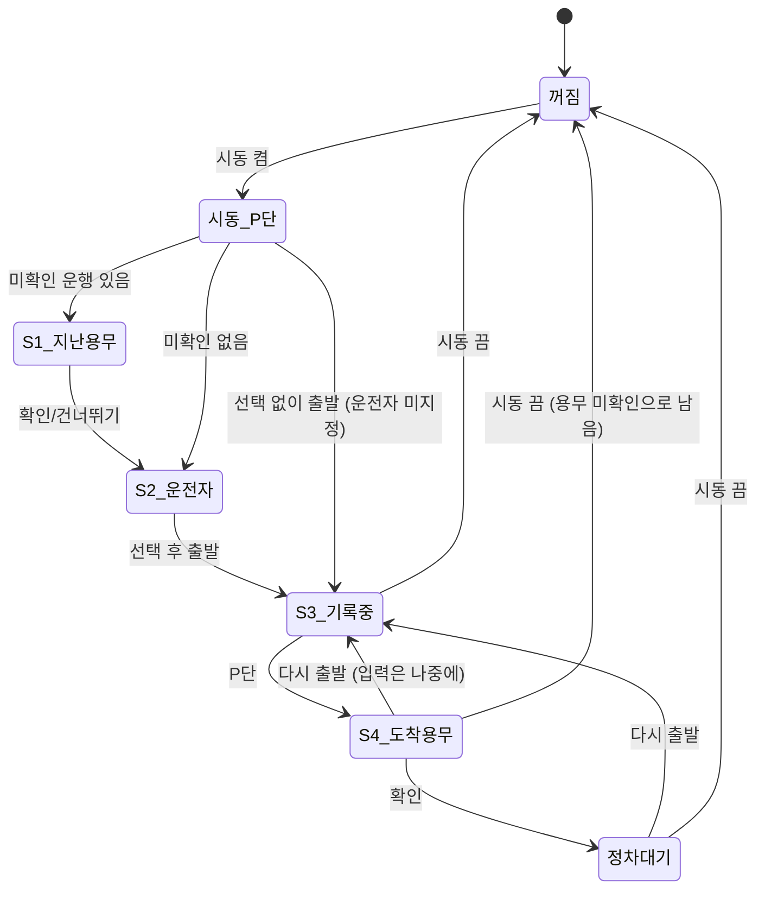

# PRD: TrueLog (가칭) — 차가 직접 쓰는 법인 차량 운행기록부

- 버전: **v0.2** (2026-10-23) · v0.1 초안을 화면·규칙·데이터·수용 기준까지 고도화
- 관련 문서: [architecture.md](architecture.md) · 결정 기록 [adr/](adr/)
- 표기: **가정** = 근거 없이 정한 값(나중에 바꿀 수 있음), **확인 필요** = 원문·에뮬레이터로 검증 전

## 1. 한 줄
시동만 걸면 차가 계기판 거리와 실제 목적지로 직접 써 주는, 사람이 고칠 수 없는 법인 차량 운행기록부.

## 2. 문제
| 문제 | 근거 (공개 자료) |
|---|---|
| 운행일지를 안 쓰거나 몰아서 써서 빠진다 | 한 지자체 관용차 운행의 46%가 일지에 없음 ([프레시안, 2023.09](https://www.pressian.com/pages/articles/2023090414051850921)) |
| 일지가 거짓이 된다 | 목적지가 주점인데 용무 '기타', 목적지명 '0' ([서울시의회 행정사무감사 보도, 2023.11](https://www.youthassembly.kr/news/746208)), 경유차에 휘발유 주유 기록 ([뉴스서울, 2022.11](https://newsseoul.co.kr/news/view/179589967381382)) |
| 폰 앱은 GPS 거리라 계기판과 다르고, 폰이 없으면 기록이 빠짐 | 폰 앱 방식 경쟁 서비스의 GPS 의존 |
| 단말기 방식은 설치·약정이 필요 | 통신사 차량관제 월 1만원대, 36~60개월 약정 |
| 기록이 없으면 비용 인정이 1대당 연 1,500만원까지 | 법인세법 제27조의2 관련 2차 자료 (원문 확인 필요) |

**폰으로는 왜 안 되나**: 계기판 누적거리, 순정 내비 목적지, 연료량은 차만 안다. 폰이 없거나 꺼져 있어도 차는 기록한다.

## 3. 목표 / 비목표
**목표 (MVP, 11/15 제출 · 12/3 PT 시연)**
1. 운전자는 탭 두 번(운전자 1탭 + 용무 1탭)으로 운행기록부 한 줄이 끝난다.
2. 기록은 지울 수 없고, 계기판 거리는 고칠 수 없으며, 사람이 고친 칸은 원래 자동값과 함께 남는다.
3. 기록이 빠진 구간(앱이 못 본 주행)은 숨기지 않고 **"기록 공백"으로 드러난다.**
4. 기간을 고르면 국세청 운행기록부 양식 엑셀을 QR로 폰에 받는다.

**비목표 (로드맵)**: 관리자 웹·여러 차 관리, 과태료 전용 기능, 차량 상태·잔존가치 리포트, 음성 입력·안내(STT·TTS 준비 중), 블루투스·Pleos 프로필 자동 식별, 법인카드·하이패스 연동, 서버 백업

## 4. 사용자
| 사용자 | 하는 일 | 원하는 것 |
|---|---|---|
| 운전 직원 | 공용차·업무용 차 운전 | 일지를 신경 쓰지 않기 |
| 차량 담당자·경리 | 직원 등록, 월말 기록 받기, 과태료 오면 운전자 찾기 | 빠진 기록 없음, 바로 낼 수 있는 파일 |
| 세무 대리인 | 운행기록부 받아 신고 | 계기판과 맞는 기록 |

대상 차량: Pleos Connect 탑재 차 중 **민간 법인 명의 업무용 승용차** ([ADR-0002](adr/0002-고객-민간-법인-차량.md))

## 5. 화면 목록
| ID | 화면 | 언제 보이나 | 입력 | 우선순위 |
|---|---|---|---|---|
| S1 | **지난 운행 용무 확인** | 시동 후 P단, 미확인 운행이 있을 때 (S2보다 먼저) | 제안값 1탭 / 다른 용무 / 건너뛰기 | P0 |
| S2 | **운전자 선택** | 시동 후 P단 | 직원 1탭 (지난 운전자 기본 선택) / 미지정 | P0 |
| S3 | **기록 중** | 주행 중 (P단 아님) | **없음** — "기록 중 · 운전자 이름"만 | P0 |
| S4 | **도착 용무 확인** | 운행 중 P단으로 바뀔 때 | 제안값 1탭 / 업무·출퇴근·개인 중 선택 / 나중에. 운전자가 미지정이면 운전자도 여기서 | P0 |
| S5 | 기록 목록 | 앱 실행 시 홈 (P단에서만 조작) | 날짜·시간대·운전자 필터 | P0 |
| S6 | 기록 상세 | 목록에서 선택 | 사람 입력 칸 수정(사유 필수). 자동값·수정 이력 표시 | P0 |
| S7 | 내보내기 | 목록에서 | 기간 선택 → QR 표시 (만료 시간 카운트다운) | P0 |
| S8 | 설정 | 목록에서 | 직원(이름·부서·위치정보 동의), 회사 위치, 출퇴근 시간대, 차량번호·법인명·사업자번호, VIN(자동) | P0 |
| S9 | 주유 기록 | 목록 탭 | 없음 (조회만) | P1 |

**주행 중 규칙**: P단이 아니면 어떤 화면에서도 입력을 받지 않는다. 입력 화면이 떠 있다가 P단이 풀리면 S3으로 바뀌고 입력은 "나중에"로 처리한다.

### 화면 흐름

## 6. 운행 감지 규칙
**한 운행 = 시동 켬부터 시동 끔까지** ([ADR-0011](adr/0011-운행-경계-시동-기준.md)). 출발·도착 계기판 거리가 기록의 기준이고, GPS·트립 값은 교차 검증용이다.

| 시점 | 저장하는 값 |
|---|---|
| 시동 켬 | 시각, 계기판 누적거리, 현재 위치 |
| 주행 중 | **체크포인트**: 계기판 거리가 1km 늘 때마다 또는 1분마다(가정) 마지막 계기판 거리·시각·위치. 앱이 갑자기 꺼져도 여기까지는 남음 |
| P단 | 내비 목적지(있으면), 현재 위치 → 용무 제안 |
| 시동 끔 | 시각, 계기판 누적거리, 도착 위치, 트립 거리·시간(교차 검증) |

### 예외
| 상황 | 규칙 | 기록에 보이는 모습 |
|---|---|---|
| **짧은 이동** (계기판 거리 변화 0km, 예: 시동만 켜고 난방) | 저장은 한다(삭제 없음). 목록·양식 본 시트에서는 숨김 | 엑셀 "운행 상세" 시트에 "이동 없음" |
| 짧은 이동 (0 초과 ~ 1km 미만, 예: 주차장 이동) | 일반 운행과 같음. 용무 제안 없이 "업무?"만 물음 | 일반 행 |
| **시동 켠 채 정차** (거래처 앞 대기·공회전) | 운행은 이어진다. P단마다 S4를 띄우되, 같은 운행에서 이미 확인했으면 다시 묻지 않음 | 한 줄. 목적지는 마지막으로 확인한 곳 |
| 시동 켠 채 여러 곳 방문 | MVP는 한 줄로 기록(목적지 여러 개는 비고에 나열). 긴 P단 정차(10분 이상, 가정) 후 출발 시 운행을 나누는 기능은 P1 | 한 줄 |
| **배터리 방전·앱 강제 종료** (시동 끔 신호를 못 받음) | 다음 시동 때 열린 운행을 **마지막 체크포인트로 닫고 "종료 추정"** 표시 | "종료 추정" 배지 |
| **기록 공백** — 새 운행 출발 계기판 > 직전 운행 도착 계기판 | 차이만큼 **"기록 공백" 행을 자동 생성** (앱이 못 본 주행) | "기록 공백 12km (10/20 18:02 ~ 10/21 08:40)" |
| 계기판 거리가 줄어듦 (계기판 교체·이상) | 공백 행 대신 "계기판 이상" 행 생성, 관리자 확인 필요 표시 | 경고 배지 |
| **앱 재설치·데이터 초기화** | 기록이 사라진다(차 안 저장만 하므로). 첫 실행 때 "기록 시작점"(계기판 거리·시각) 저장. 이전 기간은 복구 불가 → 내보내기에서 "기록 시작 전" 구간으로 표시 | "기록 시작점" 행 |
| 다른 Android 사용자로 운전 | 그 사이 주행은 이 앱에 안 보임 → 위 "기록 공백"으로 드러남 ([ADR-0012](adr/0012-Android-사용자별-데이터-분리.md)) | 기록 공백 |
| 운전자 안 고르고 출발 | "미지정"으로 기록. 도착 P단에서 S4가 운전자도 같이 물음 | "미지정" |
| 용무 확인 놓침 | "미확인"으로 남고 다음 시동 때 S1. 거기서도 건너뛰면 관리자가 S6에서 채움(사람 입력으로 표시) | "미확인" |
| 내비 목적지 없음 | 도착 위치(주소)를 목적지명으로 사용, 용무는 "업무?"로 질문 | 목적지 = 주소 |
| 기기 시각이 바뀜 | 순서는 계기판 거리와 저장 순번으로 판단. 시각은 참고 | — |

### 용무 제안 규칙 ([ADR-0004](adr/0004-용무-내비-목적지-제안-P단-확인.md))
위에서부터 처음 맞는 규칙을 쓴다.
1. 도착 위치가 내비 **즐겨찾기** 반경 200m(가정) 안 → `업무: {즐겨찾기 이름} 방문`
2. 출발 또는 도착이 **회사 위치** 반경 200m 안이고, 시동 시각이 **출퇴근 시간대**(기본 07–10시, 17–21시, 가정·설정 가능) → `출퇴근`
3. 내비 목적지 있음 → `업무: {목적지명}?`
4. 그 외 → `업무: {도착 주소}?`
- 집 주소는 저장하지 않는다. 출퇴근은 회사 위치 + 시간대로만 판단.

### 주유·충전 감지 (P1)
시동 끔 → 다음 시동 켬 사이, 또는 P단 정차 중 연료량(EV는 배터리 충전율)이 **5%p 이상(가정)** 오르면 주유/충전 기록: 시각, 위치, 증가량(%). 연료량은 기록 전용이며 양식에는 넣지 않는다.

## 7. 데이터 항목
저장은 모두 **추가만 가능한 이벤트**로 한다. 자세한 스키마는 [architecture.md §4](architecture.md#4-저장-스키마).

| 묶음 | 항목 | 누가 채우나 | 고칠 수 있나 |
|---|---|---|---|
| 차량 | VIN | 차 (`getVINInfo`) | 불가 |
| 차량 | 차량번호, 차종, 법인명, 사업자등록번호 | 관리자 (S8) | 가능 (이력 남음) |
| 직원 | 이름, 부서, 위치정보 동의 시각 | 관리자 (S8) | 이름·부서 가능, 삭제는 "비활성"으로만 |
| 운행 | 출발·도착 시각 | 차 | **불가** |
| 운행 | 출발·도착 계기판 거리, 주행거리 | 차 | **불가** |
| 운행 | 출발·도착 위치(좌표·주소) | 차 (NaviHelper) | 불가 |
| 운행 | 목적지명 | 차 (내비) | 가능 (자동값과 함께 보존) |
| 운행 | 운전자 | 사람 (S2·S4) | 가능 (이력 남음) |
| 운행 | 용무(구분: 업무/출퇴근/개인/미확인, 내용) | 제안 = 차, 확정 = 사람 | 가능 (이력 남음) |
| 운행 | 상태: 정상 / 종료 추정 / 이동 없음 | 차 | 불가 |
| 운행 | 트립 거리·시간 (교차 검증) | 차 | 불가 |
| 공백 | 시작·끝 계기판 거리, 시각 범위, 원인 추정 | 차 | 불가 (메모만 추가 가능) |
| 주유 | 시각, 위치, 증가량 | 차 | 불가 |

**"수정됨"의 뜻**: 한 번 확정된 사람 입력 칸이 나중에 바뀌었거나, 자동값(목적지명)을 사람이 바꾼 경우. 처음 확인할 때 제안과 다른 용무를 고른 것은 수정이 아니라 "선택"이며, 제안값은 함께 남는다.

## 8. 국세청 양식 칸 매핑
서식: 「업무용승용차 운행기록 방법에 관한 고시」(국세청고시 제2025-8호) 별지 서식 **업무용승용차 운행기록부**.
⚠️ **칸 이름은 널리 쓰이는 서식 기준이며 고시 원문과 대조 필요.**

| 양식 칸 | 앱 데이터 | 비고 |
|---|---|---|
| 사업연도 | 내보내기 기간 | |
| 법인명, 사업자등록번호 | 설정 | |
| 차종, 자동차등록번호 | 설정 (VIN은 별도 시트) | |
| ① 사용일자(요일) | 출발 시각의 날짜 | |
| ② 사용자 — 부서, 성명 | 운전자의 부서·이름 | 미지정이면 "미지정" |
| ③ 주행 전 계기판의 거리(km) | 출발 계기판 거리 | |
| ④ 주행 후 계기판의 거리(km) | 도착 계기판 거리 | |
| ⑤ 주행거리(km) | ④ − ③ | |
| ⑥ 업무용 사용거리 — 출·퇴근용(km) | 용무 = 출퇴근이면 ⑤ | |
| ⑦ 업무용 사용거리 — 일반 업무용(km) | 용무 = 업무이면 ⑤ | 개인·미확인은 0 (보수적으로) |
| ⑧ 비고 | 목적지명 · 용무 내용 · 배지(수정됨 n건 / 종료 추정 / 미확인) | |
| 과세기간 총주행거리 | ⑤ 합 + 기록 공백 거리 합 | 공백도 총거리에 넣는다 (숨기지 않음) |
| 과세기간 업무용 사용거리 | ⑥ + ⑦ 합 | |
| 업무사용비율 | 업무용 사용거리 ÷ 총주행거리 | 엑셀 수식으로 넣음 |

기록 공백 행: ③④⑤ 채움, ⑥⑦ = 0, 비고 "기록 공백(앱 미동작)".

**추가 시트** (양식 외): ② 운행 상세(출발·도착 시각·위치·목적지·트립 교차 검증·이동 없음 운행) ③ 수정 이력(칸, 자동값, 이전 값, 새 값, 시각, 사유) ④ 주유 기록 ⑤ 무결성(VIN, 기간, 이벤트 수, 마지막 해시, 생성 시각, 앱 버전)

## 9. 기능 요구사항과 수용 기준
| ID | 기능 | 우선 | 수용 기준 (모두 에뮬레이터에서 확인) |
|---|---|---|---|
| F1 | 운행 자동 감지 | P0 | 시동 켬→주행→시동 끔 한 번에 운행 1건이 생기고, 출발·도착 계기판 거리가 차량 값과 같다. 앱을 열지 않아도 기록된다 |
| F1-a | 체크포인트·종료 추정 | P0 | 주행 중 앱 프로세스를 죽이고 다시 시동을 걸면, 이전 운행이 마지막 체크포인트로 닫히고 "종료 추정"이 붙는다 |
| F1-b | 기록 공백 | P0 | 새 출발 계기판이 직전 도착보다 크면 차이만큼 공백 행이 생기고, 목록·엑셀 모두에 보인다 |
| F2 | 운전자 선택 | P0 | P단에서만 S2가 뜨고 지난 운전자가 기본 선택이다. 선택 없이 출발하면 "미지정"으로 저장된다. 주행 중엔 선택 버튼이 없다 |
| F3 | 용무 제안·확인 | P0 | 즐겨찾기 근처 도착 시 "업무: {이름} 방문"이 제안되고 1탭으로 확정된다. 확인 없이 시동을 끄면 다음 시동 때 S1이 먼저 뜬다 |
| F4 | 수정 이력 | P0 | 계기판 거리·시각·위치 칸에는 수정 버튼이 없다. 운전자·용무·목적지명을 고치면 사유를 받고, 목록에 "수정됨", 상세에 자동값·이전 값·새 값이 모두 보인다. DB에서 이벤트 행을 UPDATE/DELETE하면 실패한다 |
| F5 | 기록 조회 | P0 | 날짜·시간대(예: 5/12 14:00–15:00)·운전자로 거르면 그 시각에 걸친 운행만 나온다 |
| F6 | 내보내기 | P0 | 기간 선택 → 10초 안에 QR 표시(가정) → 폰으로 찍어 xlsx를 받고, 엑셀에서 열면 §8 칸이 채워져 있고 업무사용비율이 계산된다. 링크는 만료 후·1회 다운로드 후 열리지 않는다 |
| F7 | 주유 감지 | P1 | 시동 끈 동안 연료량이 32%→95%로 오르면 다음 시동 때 주유 기록 1건이 생긴다 |
| F8 | 설정 | P0 | 직원 추가 시 위치정보 동의 체크 없이는 저장되지 않는다. VIN은 자동으로 채워진다 |
| F9 | 운전자 추천 (시트 위치) | P2 | 직원별 마지막 시트 앞뒤 위치와 가장 가까운 사람이 목록 맨 위 |
| F10 | 무결성 검증 | P0 | 앱 시작과 내보내기 때 해시 체인을 검사하고, 깨졌으면 목록 상단과 엑셀 무결성 시트에 "검증 실패"를 표시한다 |

## 10. 비기능
- **오프라인 우선**: 기록은 차 안에만 저장. 네트워크는 내보내기 순간에만 사용 ([ADR-0007](adr/0007-로컬-저장소-Room.md), [ADR-0010](adr/0010-QR-내보내기-짧은-만료-링크.md))
- **신뢰성**: 이벤트는 추가만, 해시 체인으로 변조 탐지 ([ADR-0008](adr/0008-append-only-이벤트와-수정-이력.md)). 앱 백업 복원은 끈다(편집된 DB가 복원되는 것을 막기 위해)
- **개인정보**: 직원 등록 때 위치정보 수집 동의. 집 주소 저장 안 함. 내보내기 서버에 파일을 오래 두지 않음
- **보관**: 세무 증빙 보관 기간(5년으로 알려짐, 확인 필요) 동안 차 안에 유지. 용량: 하루 10운행 × 5년 ≈ 2만 운행, 이벤트 약 20만 건 → 수십 MB 이하(가정)
- **안전**: 주행 중 입력 없음. Pleos 주의 분산 가이드 준수
- **블라인드 심사**: 화면·샘플 데이터에 실존 인물·회사 이름 금지 (예시 이름은 "직원A", "OO상사")

## 11. PT 시연 시나리오 (에뮬레이터, 약 5분)
준비: 시연용 빌드(`demo`)와 시나리오 스크립트로 차량 값을 넣는다 ([architecture.md §5](architecture.md#5-데이터-소스-교체-지점)). 직원 3명(직원A·B·C), 즐겨찾기 "OO상사" 등록.

| # | 장면 | 조작 | 보여 줄 것 |
|---|---|---|---|
| 1 | 출근 후 거래처 방문 | 시동 → S2에서 직원A 1탭 → 목적지 OO상사로 주행 | 주행 중 화면은 "기록 중 · 직원A"뿐 |
| 2 | 도착 | P단 → S4 "업무: OO상사 방문" 1탭 → 시동 끔 | 목록에 12,340 → 12,368km, 28km 한 줄 완성 (탭 두 번) |
| 3 | 그냥 내림 | 다음 운행에서 용무 확인 없이 시동 끔 → 다시 시동 | S1 "지난 운행 용무 확인"이 먼저 뜸 |
| 4 | 주유 | 시동 끈 동안 연료 32% → 95% | 주유 기록 자동 생성 |
| 5 | 몰래 운행 | 앱이 꺼진 사이 계기판 15km 증가 → 시동 | **"기록 공백 15km"** 행이 자동으로 생김 — "빠진 기록도 숨길 수 없다" |
| 6 | 수정 시도 | 상세에서 계기판 거리 → 수정 버튼 없음. 용무를 고침 | "수정됨" 배지, 원래 자동값이 그대로 보임 |
| 7 | 과태료 고지서 | 목록에서 "5/12 14:00–15:00" 필터 | 그 시각 운전자 바로 확인 |
| 8 | 월말 내보내기 | 기간 선택 → QR → 폰으로 받아 엑셀 열기 | 국세청 양식 + 업무사용비율 + 수정 이력 시트 + "사람이 고친 칸 n개" |

**마무리 한 줄**: "이날 이 차 어디 갔어요?" → 계기판 거리·실제 목적지·주유 기록이 이미 있고, 빠진 구간과 고친 칸까지 전부 보인다.

## 12. 사업 모델과 지표
- **모델**: 현대차 **기본 제공 무료 앱** ([ADR-0006](adr/0006-사업모델-기본-제공-무료-앱.md)). 현대차가 얻는 것: "단말기 없이 운행기록부가 되는 차"라는 법인 판매 경쟁력, 법인 고객이 Pleos를 매일 쓰는 이유. 확장(관리자 웹, 세무 SW 연동)은 유료·제휴
- **예상 MAU (차량 기준, 가정)**: 연간 Pleos 탑재 신차 10만 대 × 법인·사업자 업무용 비중 20% × 활성화율 50% ≈ 1만 대
- **지표**: 월 1회 이상 기록 생성 차 비율(목표 80%), 용무 확인률, 운전자 미지정 비율, 기록 공백 거리 비율, 수정된 칸 비율, 월말 내보내기 횟수

## 13. 미결·확인할 것
| 항목 | 다음 행동 | 영향 |
|---|---|---|
| 시동·기어·속도를 AAOS `CarPropertyManager`로 읽을 수 있나 (에뮬레이터·실차) | 에뮬레이터 스파이크 **최우선** | F1·F2 전체. 안 되면 [ADR-0009](adr/0009-차량-데이터-추상화-계층.md)의 대체 신호 |
| 계기판 거리 단위·정밀도(0.1km?), 목적지·즐겨찾기 값 형식 | 에뮬레이터 스파이크 | 매핑, 반경 판정 |
| 국세청 서식 칸 원문 | law.go.kr 고시 원문 대조 | §8 |
| 내보내기 서버 호스팅 | 최소 구성 선택 ([ADR-0010](adr/0010-QR-내보내기-짧은-만료-링크.md)) | F6 |
| 관리 화면(S6 수정·S8 설정) 접근 제한(관리자 PIN 등) | 사용자 결정 필요. 현재는 제한 없음 — 고친 내용은 모두 남으므로 | F4·F8 |
| 업무용승용차 대수, Pleos 법인 판매 비중 | 통계·IR 확인 | MAU |
| 앱 이름 | 미정 | — |
