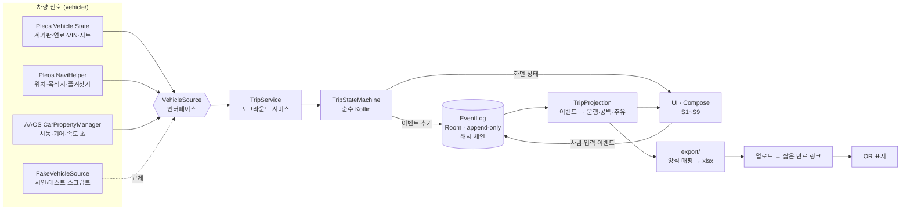
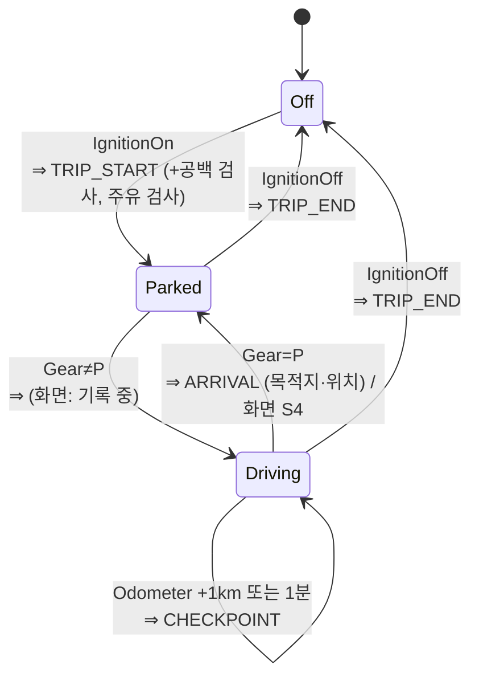

# 아키텍처 — TrueLog (가칭)

- 버전: v0.1 (2026-10-23) · 요구사항: [PRD.md](PRD.md) · 결정 이유: [adr/](adr/)
- 원칙: **작게 만든다.** Gradle 모듈 1개(`app`), 패키지로만 나눈다. 차량 신호 의존은 한 곳에 가둔다.

## 1. 한눈에 보기


## 2. 모듈(패키지) 구성
| 패키지 | 책임 | Android 의존 | 테스트 |
|---|---|---|---|
| `vehicle/` | `VehicleSource` 인터페이스와 구현 3개(`PleosVehicleSource`, `AaosCarSignals`, `FakeVehicleSource`). SDK 값을 앱 타입(`Odometer`, `Gear`, `Place` 등)으로 바꾸는 곳은 **여기 한 곳뿐** | 있음 | Fake로 대체 |
| `trip/` | `TripStateMachine`: 신호 → 상태 전이 → "추가할 이벤트 + 띄울 화면" 출력. `PurposeSuggester`: 용무 제안 규칙 | **없음** (순수 함수) | 단위 테스트 중심 |
| `log/` | `EventLog`(Room DB, 추가만), 해시 체인 계산·검증, `TripProjection`(이벤트 → 운행 목록, 공백·수정 표시) | Room | 단위 + DB 계측 테스트 |
| `export/` | `NtsFormMapper`(운행 → 양식 행), `XlsxWriter`, `ExportUploader`, QR 생성 | 일부 | 단위 테스트 (엑셀 내용 검사) |
| `service/` | `TripService`(포그라운드 서비스, 부팅 시 시작), 신호 구독 → 상태 머신 → 저장 연결 | 있음 | 에뮬레이터 확인 |
| `ui/` | Compose 화면 S1~S9. 주행 중에는 입력 컴포넌트를 그리지 않음 | 있음 | 화면 확인 위주 |

의존 방향: `ui`, `service` → `trip`, `log`, `export` → `vehicle`(인터페이스만). `trip`과 `log`는 서로의 구현을 모른다 — 상태 머신은 이벤트 값만 돌려주고, 저장은 서비스가 한다.

기술 선택: Kotlin, Jetpack Compose, Room(SQLite), Coroutines `Flow`, QR은 ZXing core(Apache-2.0). minSdk 28. 엑셀은 직접 작성(§6). 라이브러리·라이선스는 README에 표기한다(공모전 규칙).

## 3. 데이터 흐름

### 3-1. 차량 신호 → 운행 상태 머신

- 입력: `IgnitionOn/Off`, `GearChanged(P|notP)`, `OdometerTick(km)`, `Tick(시각)`. 출력: `List<NewEvent>` + `Screen`.
- 앱이 다시 시작될 때 상태 머신은 **마지막 이벤트로 복원**한다. 마지막이 `TRIP_START`/`CHECKPOINT`인데 지금 시동이 새로 켜졌으면 → 이전 운행을 `TRIP_END(estimated=true)`로 닫는다.
- `TRIP_START` 때 하는 검사 2개:
  - **공백**: 새 출발 계기판 − 직전 도착(또는 마지막 체크포인트) 계기판 > 0.1km(가정, 계기판 정밀도 확인 필요) → `GAP` 이벤트. 음수면 `ODOMETER_ANOMALY`.
  - **주유**: 연료(또는 SOC) − 직전 도착 연료 ≥ 5%p → `REFUEL`.

### 3-2. 사람 입력
S1·S2·S4·S6에서 나온 입력은 `DRIVER_SET`, `PURPOSE_SET`, `FIELD_EDIT` 이벤트로 **추가**만 된다. 이전 값을 덮어쓰지 않는다. 수정 화면은 "이 칸이 사람 입력 칸인가"를 `TripProjection`의 칸 정의로 판단하고, 자동값 칸에는 수정 버튼을 그리지 않는다.

### 3-3. 저장 → 내보내기
`EventLog.read(기간)` → `TripProjection` → `NtsFormMapper` → `XlsxWriter` → 파일 → `ExportUploader` → 링크 → QR. 내보내기 전에 해시 체인을 검증해 결과를 무결성 시트에 넣는다.

## 4. 저장 스키마
**이벤트 테이블 하나**가 원본이고, 운행 목록은 매번 계산한다(운행 수가 연 수천 건이라 메모리로 충분, 가정). — [ADR-0008](adr/0008-append-only-이벤트와-수정-이력.md)

```sql
CREATE TABLE event (
  seq         INTEGER PRIMARY KEY AUTOINCREMENT, -- 저장 순서 (시각보다 우선)
  type        TEXT    NOT NULL,  -- 아래 목록
  trip_id     TEXT,              -- 운행 UUID (운행 관련 이벤트만)
  at_wall     INTEGER NOT NULL,  -- 기기 시각 (epoch ms)
  at_boot     INTEGER NOT NULL,  -- elapsedRealtime (시각 조작 탐지용)
  odometer_m  INTEGER,           -- 계기판 거리 (m 단위 정수)
  payload     TEXT    NOT NULL,  -- JSON (타입별 값)
  prev_hash   TEXT    NOT NULL,
  hash        TEXT    NOT NULL   -- SHA-256(prev_hash | seq | type | trip_id | at_wall | odometer_m | payload)
);
CREATE TRIGGER event_no_update BEFORE UPDATE ON event BEGIN SELECT RAISE(ABORT, 'append-only'); END;
CREATE TRIGGER event_no_delete BEFORE DELETE ON event BEGIN SELECT RAISE(ABORT, 'append-only'); END;
```

| type | payload 주요 값 | 누가 |
|---|---|---|
| `LOG_START` | vin, 앱 버전 — 설치 후 첫 이벤트("기록 시작점") | 차 |
| `TRIP_START` | 위치(좌표·주소), 연료%, SOC | 차 |
| `CHECKPOINT` | 위치 | 차 |
| `ARRIVAL` | 위치, 내비 목적지명, 제안 용무 | 차 |
| `TRIP_END` | 위치, 트립 거리·시간, `estimated` | 차 |
| `GAP` | from_odometer, to_odometer, from_at, to_at | 차 |
| `ODOMETER_ANOMALY` | 직전 값, 새 값 | 차 |
| `REFUEL` | 이전 %, 새 %, 위치, 연료/전기 | 차 |
| `DRIVER_SET` | employee_id, 화면(S2/S4/S6) | 사람 |
| `PURPOSE_SET` | 구분, 내용, 제안값 | 사람 |
| `FIELD_EDIT` | 칸, 새 값, 사유 | 사람 (자동값 칸은 거부) |
| `EMPLOYEE_ADD` / `EMPLOYEE_UPDATE` / `EMPLOYEE_DEACTIVATE` | 이름, 부서, 동의 시각 | 관리자 |
| `SETTING_SET` | 키, 값 (회사 위치·출퇴근 시간대·차량번호·법인명 등) | 관리자 |
| `EXPORT` | 기간, 마지막 seq·hash | 관리자 |

- 직원·설정도 이벤트로 저장해 "누가 언제 바꿨나"가 남는다. 현재 값은 마지막 이벤트.
- 거리는 m 단위 정수로 저장해 소수 오차를 피한다. 표시는 km.
- 한 운행의 "현재 값" = 자동 이벤트 값 위에 사람 이벤트를 `seq` 순으로 덮어 계산. 같은 칸에 사람 이벤트가 2개 이상이거나 자동값 칸(목적지명)을 덮었으면 "수정됨".
- 해시 체인의 한계: 기기 루팅 후 DB 전체를 다시 만들면 탐지 못 한다. 대신 내보낸 파일에 마지막 해시가 찍혀 있어, **이미 낸 기간이 나중에 바뀌면 드러난다.** Keystore 서명·서버 앵커는 로드맵.

DB 파일은 빌드 종류별로 분리: 실차 `truelog.db`, 시연 `truelog-demo.db` (시연 데이터가 실제 기록에 섞이지 않게).

## 5. 데이터 소스 교체 지점
```kotlin
interface VehicleSource {
    val ignition: Flow<Boolean>          // AAOS IGNITION_STATE ⚠️
    val gear: Flow<Gear>                 // AAOS GEAR_SELECTION ⚠️ (P / NOT_P / UNKNOWN)
    val odometerM: Flow<Long>            // Pleos getCurrentDistanceDriven
    suspend fun vin(): String            // Pleos getVINInfo
    suspend fun energyPercent(): Energy  // Pleos getFuelPercent / getEvBatteryStateOfCharge
    suspend fun trip(): TripMeter        // Pleos getTripCurrentDrivingDistance/Time
    suspend fun location(): Place?       // NaviHelper getCurrentLocationInfo
    suspend fun destination(): Place?    // NaviHelper getDestinationInfo (없으면 getRecentDestinationInfo)
    suspend fun bookmarks(): List<Place> // NaviHelper getBookmarkInfo
}
```
| 구현 | 쓰는 곳 | 비고 |
|---|---|---|
| `RealVehicleSource` = `PleosVehicleSource` + `AaosCarSignals` | `real` 빌드 (실차·에뮬레이터) | Pleos 값이 콜백이 아니라 조회 API면 `Flow`는 주기 조회(1초, 가정)로 만든다 |
| `FakeVehicleSource` | `demo` 빌드, 테스트 | JSON 시나리오 스크립트(시각·신호 목록)를 재생. 시연 화면 구석에 "다음 단계" 버튼(데모 빌드만) |

- **교체는 빌드 종류(product flavor) `real` / `demo`로만** 한다. 실행 중 전환 메뉴는 두지 않는다 — 실차 기록에 가짜 값이 들어갈 길을 없애기 위해. 데모 빌드 화면·엑셀에는 "시연 데이터" 워터마크.
- AAOS 신호가 에뮬레이터에서 읽히면 `real` 빌드로 시연하고, 값은 `adb shell cmd car_service inject-vhal-event <속성ID> <값>`으로 넣는다(Pleos 에뮬레이터에서 되는지 **확인 필요**). 안 되면 `demo` 빌드로 시연한다.
- AAOS 신호를 못 쓸 때의 대체(실차): 시동 = 서비스 시작/종료 + 계기판 변화, P단 = "계기판 거리 20초 이상 변화 없음"(가정). 정확도가 떨어지므로 위험으로 기록 — [ADR-0009](adr/0009-차량-데이터-추상화-계층.md).

## 6. 내보내기
- **xlsx 직접 작성**: xlsx는 XML 몇 개를 zip으로 묶은 파일이라 `java.util.zip`으로 만든다(시트 5개, 문자·숫자·수식만). Apache POI는 Android에서 무겁고 호환 문제가 있어 쓰지 않는다. — [ADR-0010](adr/0010-QR-내보내기-짧은-만료-링크.md)
- 파일명: `운행기록부_{차량번호}_{시작}_{끝}.xlsx`
- 업로드: HTTPS PUT → 서버가 임의 토큰(128비트) 링크를 돌려줌 → QR. **1회 다운로드 또는 10분(가정) 후 삭제.** 서버는 파일을 열어보지 않는다.
- 서버가 없을 때(시연 백업): 파일을 앱 외부 저장소에 쓰고 `adb pull`로 꺼내 노트북에서 연다.

## 7. Android 사용자(프로필) 분리
AAOS는 운전자마다 Android 사용자를 둘 수 있고, 앱 데이터는 사용자별로 따로 저장된다. 다른 사용자로 운전한 구간은 이 앱 DB에 없다. 대응은 **기록 공백 규칙으로 드러내는 것**(계기판 거리는 차 하나에 하나이므로). 법인 차는 Android 사용자 하나로 쓰도록 안내한다. — [ADR-0012](adr/0012-Android-사용자별-데이터-분리.md)

## 8. 테스트 전략
| 층 | 무엇을 | 어떻게 | 언제 |
|---|---|---|---|
| 상태 머신 | 정상 운행, 짧은 이동, 시동 켠 채 정차, 앱 강제 종료(종료 추정), 공백, 계기판 감소, 주행 중 입력 차단 | JVM 단위 테스트. **신호 시나리오 표 → 기대 이벤트 목록** | 매 커밋 |
| 용무 제안 | 즐겨찾기·회사·시간대 경계(반경 199/201m, 06:59/07:00) | 단위 테스트 | 매 커밋 |
| 로그 | 해시 체인 생성·검증, 한 바이트 바꾸면 실패, UPDATE/DELETE 트리거 | Room 계측 테스트(에뮬레이터) | 매 커밋(가능하면) |
| 투영 | 수정 이력 → "수정됨", 현재 값 계산 | 단위 테스트 | 매 커밋 |
| 양식 매핑 | §8 칸 값, 개인·미확인 = 업무 0, 공백 행, 업무사용비율 | 단위 테스트 + 만든 xlsx를 다시 읽어 셀 값 검사 | 매 커밋 |
| 시나리오 재생 | PRD §11 시연 1~8을 `FakeVehicleSource` 스크립트로 끝까지 | 계측 테스트 — **시연에 쓰는 스크립트와 같은 파일** | 시연 전 |
| 실제 신호 | Pleos·AAOS 값이 읽히는지, 단위·형식 | 에뮬레이터 수동 체크리스트 | 스파이크 1회 + 빌드마다 |

시연 안정성 기준: 같은 스크립트로 시연 1~8을 연속 10회 실패 없이 통과.
